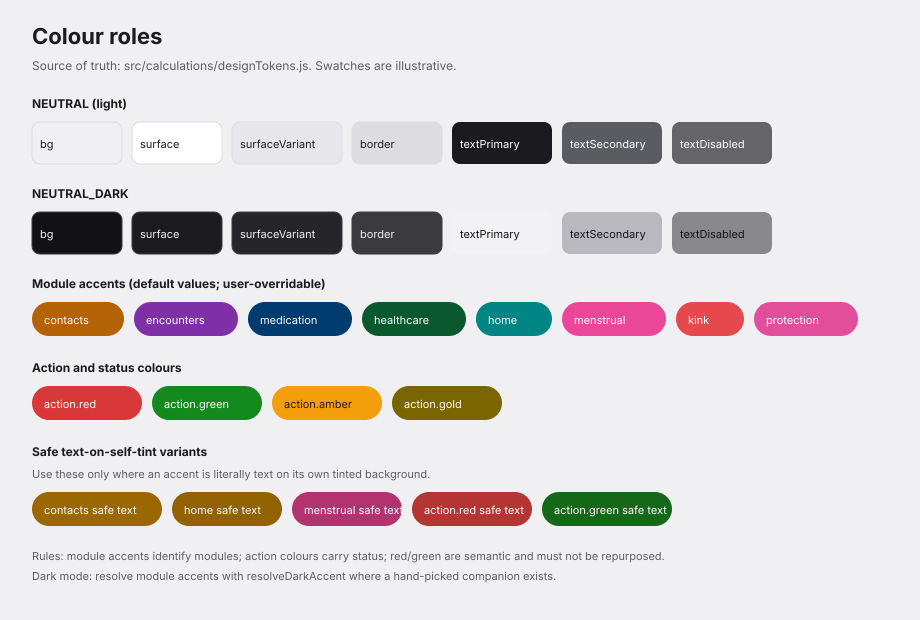
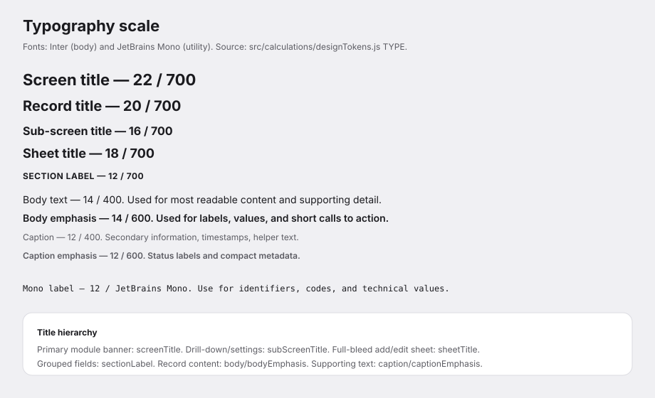
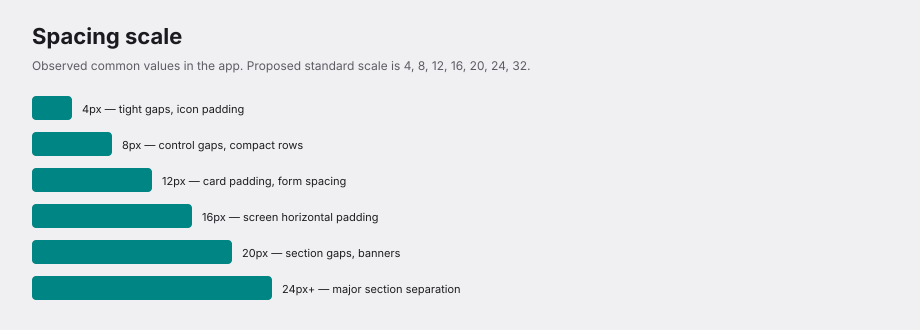
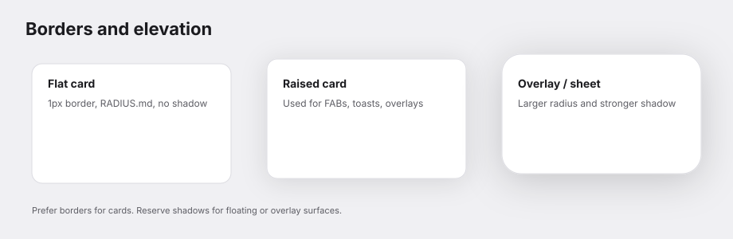
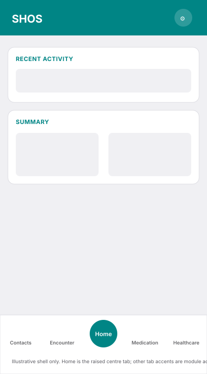
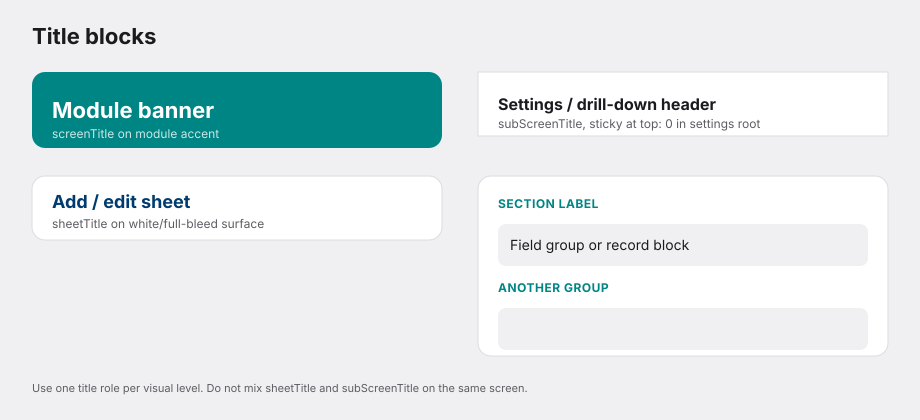
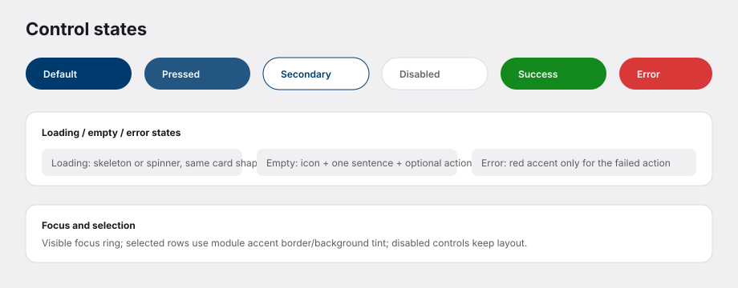

# SHOS Design Manual

This manual is a plain-English guide to how SHOS should look and behave. Start with the pictures, then use the code names when you need the exact value. It records what is settled, what is only recommended, and what still needs checking.

## 1. Scope and how to use this manual

- **Current** means the pattern is implemented and should be reused as-is.
- **Recommended** means the codebase has a common pattern, but it has not yet been promoted to a token or shared component. New work should follow the recommendation.
- **Exception** means a known gap, regression, or open audit item. Do not copy it as precedent.
- **Privacy rule for visuals:** screenshots and diagrams in this manual must use fictional demo data only. Blur or remove names, dates, locations, identifiers, notifications, status-bar details, and image metadata before publishing. Prefer token swatches and abstract mockups for public material.

The source of truth for colours, type, radius, and fonts is `src/calculations/designTokens.js`. The source of truth for module colour overrides is `src/repositories/moduleColorRepository.js`. This document should be updated in the same change when either of those changes.

## 2. Design principles

1. **Calm, local, private.** SHOS is a personal health tracker. Visual noise, identifying labels, and unnecessary motion work against the product.
2. **Module identity at a glance.** Each primary module has one accent colour. Use it for banners, active navigation, and primary actions within that module.
3. **Semantic colours mean one thing.** Red is destructive or alerting. Green is successful or positive. Amber is pending or warning. Gold is archived or low-priority. Do not use status colours as decoration.
4. **Accessibility before polish.** Contrast, touch targets, reduced motion, and screen-reader labels are part of the design, not a later pass.
5. **Shared components win.** If a presentational pattern appears in three or more modules, consolidate it before adding a fourth copy.
6. **Exceptions are named.** A deliberate deviation is documented here or in the relevant component. An undocumented deviation is drift.

## 2.5 Quick visual guide

If you are new to the app’s look, start here:

- [Colour roles](design-manual/color-roles.svg)
- [Typography scale](design-manual/typography-scale.svg)
- [App shell](design-manual/app-shell.svg)
- [Title blocks](design-manual/title-blocks.svg)
- [Spacing scale](design-manual/spacing-scale.svg)
- [Borders and elevation](design-manual/elevation.svg)
- [Control states](design-manual/state-matrix.svg)

These pictures show the intended style. The code in `designTokens.js` is the final authority.

## 2.6 Plain-language glossary

- **Accent colour:** the main colour for a module, such as Contacts or Medication.
- **Action colour:** a colour with a fixed meaning, such as red for errors.
- **Safe-area inset:** space reserved for phone status bars and navigation bars.
- **Sticky header:** a header that stays visible while the page scrolls.
- **PWA:** the web version installed like an app.
- **Redacted tier:** a privacy mode that hides most details from a home-screen widget.
- **Token:** a named value in `designTokens.js`, such as `TYPE.screenTitle`.

## 3. Colour system

### 3.1 Neutral palette

| Token | Light | Dark | Use |
|---|---:|---:|---|
| `NEUTRAL.bg` / `NEUTRAL_DARK.bg` | `#F0F0F3` | `#121214` | Screen background |
| `NEUTRAL.surface` / `NEUTRAL_DARK.surface` | `#FFFFFF` | `#1C1C1F` | Cards and sheets |
| `NEUTRAL.surfaceVariant` / `NEUTRAL_DARK.surfaceVariant` | `#E7E7EB` | `#26262A` | Inputs and recessed areas |
| `NEUTRAL.border` / `NEUTRAL_DARK.border` | `#DCDCE1` | `#3A3A3F` | Borders and dividers |
| `NEUTRAL.textPrimary` / `NEUTRAL_DARK.textPrimary` | `#1B1B1F` | `#F2F2F4` | Primary text |
| `NEUTRAL.textSecondary` / `NEUTRAL_DARK.textSecondary` | `#5B5B62` | `#B8B8BE` | Secondary text |
| `NEUTRAL.textDisabled` / `NEUTRAL_DARK.textDisabled` | `#656568` | `#89898C` | Disabled or muted text |

### 3.2 Module accents

Default accents are defined in `DEFAULT_ACCENTS`. Users can override module accents and action red/green in Settings. Overrides apply on the next app reload, not instantly, because modules read these values at load time.

| Module | Token | Default |
|---|---|---:|
| Contacts | `ACCENTS.contacts` | `#B36205` |
| Encounters | `ACCENTS.encounters` | `#7F30A6` |
| Medication | `ACCENTS.medication` | `#003B6F` |
| Healthcare | `ACCENTS.healthcare` | `#09582E` |
| Home | `ACCENTS.home` | `#008585` |
| Menstrual | `ACCENTS.menstrual` | `#EB4799` |
| Kink registry | `ACCENTS.kink` | `#E5484D` |
| Protection registry | `ACCENTS.protection` | `#E24E9C` |

### 3.3 Action colours

| Token | Default | Meaning |
|---|---:|---|
| `ACTION.red` | `#D93838` | Destructive, alert, failed, or attention-required |
| `ACTION.green` | `#148A1E` | Success, complete, healthy, or positive |
| `ACTION.amber` | `#F59E0B` | Pending, warning, or needs review |
| `ACTION.gold` | `#7A6500` | Archived, low-priority, or historical |

### 3.4 Safe text-on-self-tint variants

Use these only where an accent is literally used as text on its own tinted background. They are darker stand-ins and must not replace the base accent in filled buttons, borders, or icons.

| Variant | Value | Notes |
|---|---:|---|
| Contacts safe text | `#9A6700` / text-safe equivalent | For contacts tinted badges |
| Home safe text | `#926100` | Used for Home summary labels |
| Menstrual safe text | `#B33370` | Added for menstrual accent text |
| Action red safe text | `#B53434` | For red text on red tint |
| Action green safe text | `#146818` | For green text on green tint |

### 3.5 Dark mode and custom colours

- Use `NEUTRAL_DARK` for dark-mode surfaces and text.
- Use `resolveDarkAccent(overrideKey, currentValue, defaultDarkValue)` where a module has a hand-picked dark-mode companion. Encounters, Medication, and Healthcare have such companions.
- Custom colours are stored through `ModuleColorRepository`. A change does not instantly repaint open screens; it applies on the next reload.
- Dark-mode resolution happens at render time in shared chrome such as the bottom navigation, not in the module-level `TABS` array, because the always-light restore preview must not resolve for dark mode.

### 3.6 Colour rules

- Do not hardcode hex values in new UI. Read from `NEUTRAL`, `NEUTRAL_DARK`, `ACCENTS`, `ACTION`, or a repository-backed override.
- Do not use `ACTION.red` for a module identity colour. Menstrual once reused red for lack of its own token; it now has `ACCENTS.menstrual`.
- Do not use a module accent as small body text on its own tint unless the safe-text variant is used.
- Check contrast for any new colour. White text on filled buttons needs 4.5:1. Icons and large text need at least 3:1.
- Dark-mode companions must clear both the dark surface contrast and white-text contrast where they are used as fills.

### 3.7 Known colour exceptions

- Home's active-session border previously used `ACCENTS.encounters` in dark mode without `resolveDarkAccent`. This is an open audit item, not a pattern to copy.
- Menstrual accent text reaches only 3.56:1 on white. It is accepted for icons, large text, and UI components, but not small body text.
- **Raw accents used as text/labels without dark resolution (B1–B9):** Contacts, Home, Menstrual and MyProfile have no dark companion, so their accents used as text fail in dark mode (3.78:1 for Contacts). DesignScreen's "Customise" link uses raw `ACCENTS.medication` (1.50:1). Encounters kink tags use raw `ACTION.red` as decoration (3.70:1). The "Incomplete" chip hardcodes light-only `#926100`/`#FFF3C4`. Contacts select-mode bar hardcodes `#1B1B1F`. Settings subscreens (About, Stats, Resources, Share, DeveloperTools) use raw accents as text/labels. Do not copy these; resolve with `resolveDarkAccent` and a hand-picked companion.

## 4. Typography

Fonts are self-hosted through `@fontsource/*` and imported in `src/main.jsx`. Do not add a render-blocking Google Fonts link.

- Body font: `FONT_FAMILY = "'Inter', sans-serif"`.
- Utility/mono font: `FONT_FAMILY_MONO = "'JetBrains Mono', monospace"`.

### 4.1 Type scale

| Token | Size / weight | Use |
|---|---:|---|
| `TYPE.screenTitle` | 22 / 700 | Primary module banner (Contacts, Encounters, Medication, Healthcare, Settings) |
| `TYPE.recordTitle` | 20 / 700 | Record or detail title |
| `TYPE.subScreenTitle` | 16 / 700 | Settings and drill-down headers |
| `TYPE.sheetTitle` | 18 / 700 | Full-bleed add/edit sheet title |
| `TYPE.sectionLabel` | 12 / 700, uppercase, letter-spacing 0.5 | Group labels and section headings |
| `TYPE.body` | 14 / 400 | Main readable content |
| `TYPE.bodyEmphasis` | 14 / 600 | Labels, values, short actions |
| `TYPE.caption` | 12 / 400 | Secondary information and helper text |
| `TYPE.captionEmphasis` | 12 / 600 | Status labels and compact metadata |
| `TYPE.microLabel` | 11 / 600 | Micro-text floor: badges, chips, status lines. Do not go below 11px except the 9px DEMO badge (explicit exception). |
| `TYPE.monoLabel` | 12, JetBrains Mono | Identifiers, codes, technical values |

### 4.2 Typography rules

- Set `FONT_FAMILY` explicitly on screen-level root containers. Healthcare previously rendered in the browser default because it omitted this.
- Do not invent new font sizes for a one-off. If a new recurring role appears, add a token.
- **List-card title:** 15px / 600. Encounters was the outlier at 700; corrected to 600. (C4)
- Use `TYPE.sectionLabel` for grouped field labels, not ad hoc uppercase styling.
- Use JetBrains Mono only for utility values, not general body text.

## 5. Spacing and layout

The app uses inline styles, so spacing is currently expressed directly. The most common values are 4, 8, 12, 14, 16, 20, and 24 pixels. New work should use this recommended scale:

| Step | Value | Common use |
|---:|---:|---|
| 1 | 4px | Tight gaps, icon padding |
| 2 | 8px | Control gaps, compact rows |
| 3 | 12px | Card padding, form spacing |
| 4 | 16px | Screen horizontal padding |
| 5 | 20px | Section gaps, banners |
| 6 | 24px+ | Major section separation |

### 5.1 Layout rules

- Screen horizontal padding is usually 16px.
- Cards usually use 12-14px internal padding.
- Vertical gaps between related fields are usually 8-12px.
- Use full-width cards with 16px side margins on phone layouts.
- Keep touch targets at least 44px high for interactive controls.
- Do not put `minHeight: 44` on an inline SVG icon. It scales the glyph. Use padding or a negative margin on the parent instead.

## 6. Shape, borders, and elevation

- `RADIUS.sm = 8` for inputs and small controls.
- `RADIUS.md = 13` for cards and standard containers.
- `RADIUS.lg = 24` for larger sheets.
- `RADIUS.full = 999` for pills, FABs, and circular controls.
- Standard cards use a 1px border in `T.border` and no shadow.
- Use shadows for floating or overlay surfaces: FABs, toasts, dialogs, and sheets.
- Prefer borders over shadows for ordinary cards. Borders are more stable across light and dark mode.
- **Elevation rule:** ordinary list cards get no shadow. Shadows are reserved for floating/overlay surfaces. Contacts was the only list card with a shadow; it has been removed (C2).

## 7. App shell and navigation

- Bottom navigation has five tabs: Contacts, Encounter, Home, Medication, Healthcare.
- Home is the raised centre tab and is visually distinct from the other four. It is an **intentional exception**: always-filled 48 dp circle, no label, no state change when active. Do not copy this as a pattern for other tabs.
- Tab accents come from `ACCENTS` and are resolved for dark mode at render time.
- The bottom nav stays on record/detail screens and hides on Settings and other full-screen stacks.
- Tab order can be customised, but Home remains in the centre position.
- My Profile is not a primary tab. It is reached from Home or Settings.
- Settings is reached from the gear icon on Home.
- Global Search is available from the header and searches across modules.

### 7.1 Header and title blocks

| Role | Token | Where |
|---|---|---|
| Primary module banner | `TYPE.screenTitle` | Bottom-nav module screens |
| Settings/drill-down header | `TYPE.subScreenTitle` | Settings and sub-screens |
| Add/edit sheet title | `TYPE.sheetTitle` | Full-bleed coloured sheet |
| Grouped field label | `TYPE.sectionLabel` | Card or form section |

- **Section-label colour has three roles, not one.** Module accent when the label names a group *of the module's own records*; `textSecondary` when it names a field group inside a form or card; `textDisabled` only for a label sitting directly above an already-disabled value. Same size and weight in all three — the colour carries the role, so do not add a fourth variant for emphasis.

- Module banners use the module accent background with white text.
- **Home header** is a non-banner title (22/700) with up to 5 icons (Lock, Search, My Profile, Settings, Quick exit) and a 4 px accent bar underneath. Keep the icon count to 4 on narrow screens to avoid title wrap.
- Settings headers are sticky at `top: 0` inside a root that already carries the safe-area top padding.
- Sub-module sticky subheadings use `STICKY_SUBHEADING_TOP`.
- **Banner control budget:** title, then at most 2 module actions, then global actions (Quick exit always last). Select should live in the list toolbar, not the banner.

## 8. Sticky headers and safe areas

- Screen roots carry `paddingTop: env(safe-area-inset-top)`.
- Settings screen headers stick at `top: 0`, not at an additional safe-area offset. Adding the inset again creates a gap.
- Healthcare subheadings use `STICKY_SUBHEADING_TOP = calc(env(safe-area-inset-top) + 58px)`. This is the height of a **single-band** module banner. Only valid when the sticky header above is exactly one band. Multi-band headers (e.g. Healthcare's two-row sub-tab stack) need a measured height instead.
- **Sheet rule:** inside a sheet's own scroll container, the sticky offset is `0`, never the screen offset. Use a `stickyTop` prop (default `0`) on shared components like `FormTabs`.
- Do not copy a hardcoded sticky offset from another screen. Use the shared constant.
- Check comments near sticky code before changing it. Some values were settled by on-device measurement.

## 9. Icons

- Icons come from `@phosphor-icons/react` only. Do not import `lucide-react`.
- Alias Phosphor icons to their original lucide-style names in one import block.
- Common sizes: 12px for compact metadata, 14-16px for controls, 18-20px for headers, 22px for navigation.
- Common weights: `regular`, `bold`, and `fill` for active states.
- Icons are decorative unless they carry meaning. Provide an accessible label for icon-only controls.
- Icon-only elements are audited by `iconOnlyUIAudit.test.js`.
- **No emoji as icons.** Icons are Phosphor-only. Never use emoji as a stored value or display glyph (e.g. Testing's setting field used "🏠 Home" as a data key).

## 10. Forms, cards, lists, and dialogs

### 10.1 Forms

- Group fields in `SectionCard` or an equivalent card.
- Use `RADIUS.sm` for inputs and `RADIUS.md` for cards.
- Inputs use `surfaceVariant` backgrounds and `border` outlines.
- Labels use `TYPE.bodyEmphasis` or `TYPE.caption`, depending on density.
- Keep related fields vertically spaced by 8-12px.
- Validation errors use `ACTION.red` text and appear directly under the failed field.
- **Standard search/filter field:** `surfaceVariant` background, 1px `border` outline, `RADIUS.sm`, 8/12px padding, 13px font, `minHeight: 44`, and an `aria-label` matching the placeholder. Applies to every list filter, including in-sheet pickers (Testing's link pickers, Menstrual's suggestion picker). The one deliberate exception is the global search bar, which is borderless inside its own container so the container reads as the field.

### 10.2 Cards

- Standard card: white/surface background, 1px border, `RADIUS.md`, 12-14px padding.
- Do not add a shadow to an ordinary card.
- Use module accent only for the card's label or primary action, not the whole card.

### 10.3 Lists

- Rows should have consistent height and spacing.
- Empty states should use an icon, one sentence, and an optional action. Implement with the shared `EmptyState` component (`src/components/EmptyState.jsx`) rather than a new inline div; it is for list-level states only — field placeholders such as "No notes yet" stay plain text.
- Archived or historical items should use `ACTION.gold` or muted styling, not red.

### 10.4 Dialogs and overlays

- Modal overlays should use `role="dialog"` and `aria-modal="true"` where appropriate.
- Escape-to-close should be wired with `useEscapeToClose`.
- Fixed overlays are not all modals. Review intent before adding dialog semantics.
- Overlay back behaviour should use the shared overlay back stack where applicable.

### 10.5 Loading, empty, and error states

- Loading states should preserve the final layout shape where practical. Use `SkeletonList` / `SkeletonRow` from `src/components/Skeleton.jsx` for inline module loads; keep a plain "Loading..." only for full-screen transitions (App launch, Settings full-screen push).
- Empty states should not look like errors. Use `EmptyState` from `src/components/EmptyState.jsx` — it supplies the icon, sentence and optional action, and defaults to the same 40/20 padding and 13px text the old inline divs used.
- Error states should use red only for the failed action or invalid value.
- Disabled controls should remain visible and keep their layout.

## 11. Responsive and desktop behaviour

- The app is phone-first.
- `useIsDesktopWidth` controls desktop-specific layout changes.
- Desktop layouts may use wider inputs, multi-column glossaries, and larger pickers.
- Do not assume a fixed phone width in new components.
- Test long translated strings and small screens.

## 11.5 Platform differences: Android APK, web, and PWA

SHOS ships the same React UI to all platforms, but the surrounding shell and capabilities differ. Design and test against the lowest common denominator, then add platform-specific affordances.

| Area | Android APK | Web | PWA |
|---|---|---|---|
| Shell | Capacitor WebView, native status bar, system navigation | Browser chrome and tabs | Installed app window, possible browser chrome |
| Back behaviour | Hardware back button plus in-app back | Browser back button | Browser/app back button |
| Safe areas | Status bar and navigation bar insets | Usually none, but browser UI can obscure content | Installed-mode insets vary by browser |
| Offline | Fully local by design | Depends on network unless cached | Service worker cache supports offline after install |
| Notifications | Local notifications and widget updates | Browser notification permission | Browser notification permission |
| Home-screen widgets | Supported through Android AppWidget | Not supported | Not supported |
| Files and sharing | Android storage access framework | Browser download/share APIs | Browser download/share APIs |
| Security | App Lock, biometrics, screenshot controls | PIN gate only where supported | PIN gate only where supported |
| Install/update | APK release | URL access | Install prompt and update checks |

### 11.5.1 Platform design rules

- Always provide in-app back and close controls. Do not rely only on the browser or hardware back button.
- Keep primary actions reachable without hover. Hover-only interactions do not work on touch devices.
- Use safe-area insets for fixed headers, bottom navigation, and bottom sheets.
- Avoid viewport assumptions that exclude browser chrome or system bars.
- Show clear offline/unavailable states when a platform capability is missing.
- Gate platform-only features behind capability checks rather than user-agent guesses where possible.
- Treat widget, notification, biometric, and file features as Android-only unless explicitly implemented elsewhere.
- Test web/PWA changes in a browser and Android changes on a device or CI APK.

### 11.5.2 Platform-specific UI

- Biometric unlock appears only where the platform supports it.
- The install prompt appears only in web/PWA contexts.
- Home-screen widgets are Android-only and must follow widget privacy and layout guards.
- Screenshot and screen-security controls are Android-specific.
- Deep links and URL handling need explicit testing in web/PWA.

## 12. Accessibility

- Reduced motion is supported through `useReducedMotion`. Respect it for transitions and animated UI.
- Quick exit is available on screens and must remain functional. A visible panic control that does nothing is worse than no control.
- Touch targets should be at least 44px high for interactive controls.
- Use `aria-live="polite"` for status updates.
- Icon-only controls need accessible labels.
- Contrast must pass WCAG for text and UI components.
- Keyboard navigation should work for header icons and interactive elements.

## 13. Privacy-sensitive UI

- Do not put identifying health details in widget picker labels.
- Widget tiers are `full`, `redacted`, and `off`. Redacted uses default-deny allowlists.
- Fields not allowed at redacted tier must render as `GONE`, not blank.
- Structural labels at redacted tier should also be hidden when their rows are hidden.
- Disclosure level controls notification text only. It is separate from widget tier.
- Anonymise mode hides identifying details across notification surfaces.
- Screenshots and documentation must use fictional data only.

## 14. Common design mistakes and fixes

| Symptom | Likely cause | Preferred fix |
|---|---|---|
| Gap above a sticky settings header | Safe-area inset counted twice | Root carries top safe-area padding; sticky header uses `top: 0` |
| Subheading overlaps or gaps | Hardcoded sticky offset | Use `STICKY_SUBHEADING_TOP` |
| Screen renders in browser default font | Missing `FONT_FAMILY` on root | Set `FONT_FAMILY` explicitly |
| Accent text fails contrast on tint | Base accent used as text on its own tint | Use safe-text variant or darken stand-in |
| Dark-mode accent looks wrong | Raw `ACCENTS` value used without resolution | Use `resolveDarkAccent` |
| Chips or switches become oversized | `minHeight: 44` applied to inline SVG or chip | Use padding/negative margin on parent |
| Overlay does not close with Escape | Missing `useEscapeToClose` | Wire hook and check dialog semantics |
| Content scrolls through header | Scroll container lacks safe-area handling | Review sticky/safe-area comments before editing |
| Custom colour does not update immediately | Modules read accents at load time | Reload app; document as expected |
| Red used for a non-error state | Semantic colour misused | Use module accent or neutral styling |
| Empty card looks broken | Empty state not designed | Add icon, sentence, optional action |
| Long translated text overflows | Fixed width or missing wrap | Test long strings and small screens |
| Feature works on web but not APK/PWA | Platform capability assumed | Gate feature by capability and test on target platform |

## 15. Frequently asked questions

**Which title style should I use?**  
Use `screenTitle` for primary module banners, `subScreenTitle` for settings and drill-down headers, `sheetTitle` for full-bleed add/edit sheets, and `sectionLabel` for grouped fields.

**Should a new feature use a module accent or a status colour?**  
Use the module accent for identity and primary actions. Use action colours only for status, validation, or destructive actions.

**How do I handle dark mode?**  
Use `NEUTRAL_DARK`, resolve module accents with `resolveDarkAccent`, and check contrast. Do not assume a light-mode colour will work on a dark surface.

**When should I create a shared component?**  
When a presentational component or helper is duplicated in three or more modules, or has been the site of a repeated bug. Consolidate it and make deliberate differences props.

**How should I choose spacing?**  
Use the recommended scale. Prefer 16px horizontal screen padding, 12-14px card padding, and 8-12px field gaps.

**Which icons are allowed?**  
Phosphor icons only, imported through the established alias pattern. Do not add lucide-react.

**How do I show an empty state?**  
Use an icon, one sentence, and an optional action. Keep it visually distinct from an error.

**Can I include screenshots in documentation?**  
Yes, but only with fictional demo data and no identifying details. Prefer swatches and abstract mockups for public repositories.

## 16. New feature checklist

Before shipping a new screen or component, check:

- [ ] Uses tokens instead of hardcoded colours, fonts, and radii.
- [ ] Has a clear title role.
- [ ] Uses module accent for identity and action colours only for status.
- [ ] Works in light and dark mode.
- [ ] Uses safe-area handling correctly.
- [ ] Sticky headers use shared constants.
- [ ] Touch targets are at least 44px.
- [ ] Icons are Phosphor and have accessible labels where needed.
- [ ] Empty, loading, and error states are designed.
- [ ] Long translated strings and small screens are considered.
- [ ] Reduced motion is respected.
- [ ] Privacy-sensitive data is not exposed in labels, widgets, or screenshots.
- [ ] Platform differences (APK, web, PWA) have been considered.
- [ ] Any new shared pattern is documented or consolidated.

## 17. Known gaps and exceptions

These are current audit items. They are not standards and should not be copied. Each item should be checked against current code before it is treated as open work.

### 17.1 Resolved or no longer applicable

- Home's active-session border now uses the dark-mode accent resolver.
- Some settings screens already use the shared Escape handler; the blanket "settings screens lack Escape" claim is not accurate.
- The manual no longer lists i18n adoption, CRUD smoke-test coverage, or device validation as design-system issues. Those belong to their own work areas.

### 17.2 Needs verification before calling it open

- Settings Escape handling: several screens use it, but the full set has not been re-audited screen by screen.
- Settings touch targets: the old count of `cursor: pointer` sites does not prove the tap area is too small. Padding and surrounding controls also matter.
- Fixed overlays: a floating panel is not always a dialog. Each one needs an intent review before adding dialog semantics.

### 17.3 Confirmed open

- (Device validation moved to §11.5 platform testing guidance.)

## 18. Change policy

- Update `designTokens.js` and this manual in the same change when a token changes.
- Add a new token before introducing a new recurring visual value.
- Document deliberate exceptions in section 17 or the relevant component.
- Keep visual references privacy-safe.
- Do not turn observed variation into a rule without checking whether it is intentional.
- When a design pass changes the visual language, preserve semantic roles so accessibility and privacy behaviour remain stable.